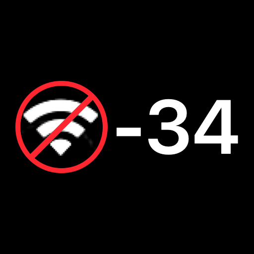

# WiFi RSSI Enabler

WiFi RSSI Enabler replaces the Wi-Fi bars with your iPhone’s RSSI (Received Signal Strength Indicator), a measure of how much Wi-Fi signal power the phone receives from its connected access point. The readout is in dBm, a logarithmic unit referenced to one milliwatt. The status bar shows just the number, so `-34` means **-34 dBm**.

**Closer to zero means a stronger signal.** For example, -50 dBm is stronger than -70 dBm. Watch the number as you move around to spot weak areas or find a better place for your router. RSSI measures signal strength, while download speed depends on other factors too.

Cellular bars stay visible. On iOS 26, the Control Center readout matches the carrier font when visible and uses 16-point regular when the carrier label is absent. A fixed width reserves space for the signed reading next to the VPN badge.

## Installation

Download the matching package from [Releases](https://github.com/sahinkaa/WiFiRSSIEnabler/releases) and respring after installing. Tested on iOS 16.6 and iOS 26.0.1 with RootHide. The rootless build targets iOS 16 and later and has been checked on the build host.

## Build

With Xcode, ldid and Theos configured, run `make package FINALPACKAGE=1 THEOS_PACKAGE_SCHEME=rootless` for rootless or use `THEOS_PACKAGE_SCHEME=roothide` with RootHide Theos.
